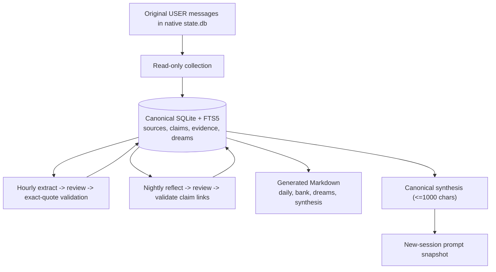

<div align="center">

<!-- logo -->


# Hermes Muse Memory

**Evidence-backed long-term memory for Hermes Agent — original user quotes become
cited, searchable claims with bounded guidance for new conversations.**

[](LICENSE)
[](https://www.python.org/downloads/)
[](https://www.sqlite.org/fts5.html)
[](https://github.com/illocean/hermes-muse-memory)
[](.github/workflows/checks.yml)

<p>
  <a href="#quick-start">Quick Start</a> ·
  <a href="docs/USAGE.md">Usage</a> ·
  <a href="docs/ARCHITECTURE.md">Architecture</a> ·
  <a href="docs/VERIFICATION.md">Verification</a> ·
  <a href="docs/COMPARISON.md">Comparison</a>
</p>

</div>

> **Published 2026-11-07** as [illocean/hermes-muse-memory](https://github.com/illocean/hermes-muse-memory).
> An independent implementation inspired by [Muse's public memory blueprint](https://mouse.dev/img/blog/muse/memory-diagram.webp)
> and [runtime article](https://mouse.dev/blog/muse-runtime-export/). It does not contain Muse's runtime, private archive, or training code.
> It uses Hermes plugins and native cron without modifying Hermes core.

## ✨ Features

- **Evidence-backed claims** — every claim must quote an original `USER` message exactly; a separate model review must approve it.
- **Auditable recall** — `search` finds active claims (SQLite FTS5 keyword), `explain` returns the exact quote with native session/message IDs and a daily-file citation.
- **Bounded synthesis** — nightly reflection produces short guidance; new sessions inject at most 1000 chars of canonical synthesis. Resumed prompts stay frozen.
- **Explicit forgetting** — `forget <claim-uuid>` removes linked sources, supersession chains, dreams, guidance, and search entries; hash tombstones block exact relearning.
- **Local-first, small archives** — SQLite canonical store, no database server, no embeddings; hourly/nightly inference is skipped when nothing changed.
- **Generated views** — `daily/`, `bank/world|experience|opinions|reflections.md`, `dreams/`, `ALIGNMENT_SYNTHESIS.md` are regenerated from SQLite.

> A user statement remains a user statement; confidence is a model estimate.
> Not image recall, guaranteed semantic search, unbounded backlogs, or verified facts about external systems.

## ⚡ Quick Start

```powershell
hermes plugins install illocean/hermes-muse-memory/plugins/muse-memory --enable
hermes muse-memory status
```

Then open a **new** Hermes CLI conversation and state a lasting preference or convention.
Collection starts at first activation; old history is not bulk-imported.

See [docs/INSTALL.md](docs/INSTALL.md) for hourly/nightly workers and the Windows tick,
[docs/USAGE.md](docs/USAGE.md) for search / explain / record / forget,
and [AGENT_INSTALL_PROMPT.md](AGENT_INSTALL_PROMPT.md) for one-prompt agent installation.

### Tool actions

| Action | Purpose |
| --- | --- |
| `status` | Archive counts and metadata |
| `sources` | Pending original source messages |
| `record` | Propose claims with known source keys + exact quotes (review runs first) |
| `search` | Find active claims by keywords |
| `explain` | Inspect claim, evidence, and citation |
| `forget` | Remove explicitly requested claim and dependent archive data |

Native `MEMORY.md`, `USER.md`, and `SOUL.md` stay under Hermes's own mechanisms.
Installation applies to the selected Hermes home/profile; other profiles install separately.

**Privacy:** storage is local, but extraction/review/reflection send relevant evidence to your
configured Hermes model provider — not an offline-only system. No provider credentials are in this repo.
Source filtering skips messages changed by forced secret redaction; it is not a guarantee against every secret.

**Forgetting scope:** deleting an archive claim removes its source copies and derivatives.
Native chat history, native curated memory, frozen prompts, external backups, and every possible
paraphrase are outside that deletion scope. Start a new conversation after changing guidance.
See [docs/USAGE.md#forgetting](docs/USAGE.md#forgetting).

## 🏗 Architecture



See [docs/ARCHITECTURE.md](docs/ARCHITECTURE.md) for trust boundaries, data contracts, and Mermaid details.

## 📁 Repository

```text
plugins/muse-memory/     plugin, SQLite store, and runnable checks
scripts/                 native cron workers + check_integrity.py
docs/                    ARCHITECTURE, INSTALL, USAGE, VERIFICATION, INTEGRITY, COMPARISON
.github/workflows/       standalone CI (store + integrity on ubuntu/windows)
assets/                  logo.svg + social-preview.png
AGENT_INSTALL_PROMPT.md  copyable agent installation prompt
SHA256SUMS               shipped-file checksums
```

```powershell
python -I -B plugins/muse-memory/test_store.py
python -I -B scripts/check_integrity.py
```

Live integration checks require an installed Hermes runtime; see [docs/VERIFICATION.md](docs/VERIFICATION.md).
CI checks the standalone store and checksums, not your provider or Windows scheduler.

## 🏷 Topics & Badges

Repo topics (tags): `hermes-agent`, `muse-memory`, `memory`, `sqlite`, `fts5`, `plugin`,
`consolidation`, `python`, `evidence-backed`, `llm-memory`.

Badges are static shields in this README; license is MIT ([LICENSE](LICENSE)).

## 📜 License & Attribution

MIT licensed. The public Muse description informed the workflow; no unpublished Muse source was
available or copied. Hermes is a separate project by Nous Research. This repository is not affiliated
with either author. See [LICENSE](LICENSE) and [docs/ARCHITECTURE.md](docs/ARCHITECTURE.md).
Publication follows an explicit 2026-11-07 override of the earlier Mnemosyne-comparison hold; it does
not claim superiority over Mnemosyne (see [docs/COMPARISON.md](docs/COMPARISON.md)).
