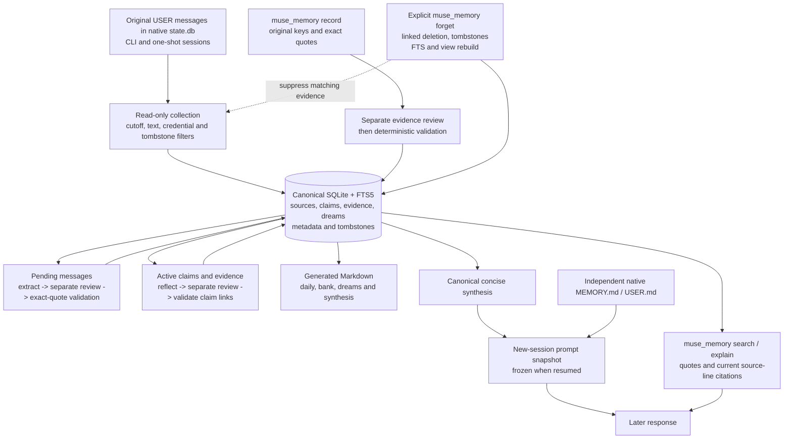
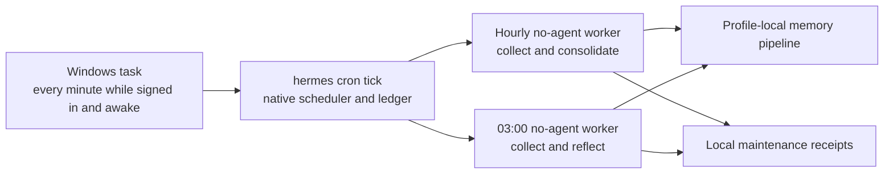

# Architecture

Hermes Muse Memory adds an evidence-backed archive to Hermes CLI. It captures original user messages, reviews durable claims, keeps their citations, and derives short guidance for later sessions. It is an independent adaptation of the workflow described in the [Mouse article](https://mouse.dev/blog/muse-runtime-export/) and [Muse memory blueprint](https://mouse.dev/img/blog/muse/memory-diagram.webp). Muse's runtime archive and implementation were not published by the article's author; this project does not reproduce that unavailable runtime or claim compatibility with Meta Muse.

The published blueprint connects conversation evidence, consolidation, searchable claims, derived notes, nightly reflection, later recall, and linked forgetting. This implementation follows those relationships using Hermes plugin APIs and a local SQLite database.

## Data and trust boundaries

The archive belongs to the active Hermes profile under `memories/muse/`. The first initialization records an immutable collection cutoff. Collection reads native `cli` and `oneshot` sessions through `SessionDB(read_only=True)`; it does not write native history or bulk-import older conversations. Gateway and cron sessions, compressed summaries, messages without usable text, and text over 12,000 characters are excluded. Only text portions of multimodal messages are collected. Messages changed by Hermes's forced credential redactor are skipped. A source key combines the native message identity with a content fingerprint, preserving separate revisions.

An accepted claim stores its kind, confidence, status, source identities, and exact contiguous quotes from original **user** messages. Extraction and review are separate inference calls using the configured Hermes model; they are not independent providers. The store then enforces structural and exact-quote constraints. Corrections can supersede an older active claim when the reviewer approves the correction relationship. Confidence remains a model estimate. A user's report about a file, machine, service, or past event is evidence of that report, not verification of the underlying system.

SQLite is authoritative. `daily/`, `bank/`, `dreams/`, and `ALIGNMENT_SYNTHESIS.md` are generated views. The four bank pages represent world claims, experiences, opinions, and reflections. Transactions serialize writers, and generated files are replaced atomically. Edited Markdown does not become accepted evidence or prompt instructions; canonical rows generate the injected synthesis. File and line citations are recomputed because retraction can move lines.

Native `MEMORY.md`, `USER.md`, and the native `memory` tool remain separate. Consolidation does not automatically promote claims into those files. Native `session_search` still retrieves raw conversation history; `muse_memory search` retrieves active reviewed claims through keyword FTS5. `explain` exposes their original quotes and source citations. The model-facing tool also provides `status`, `sources`, `record`, and `forget`; the CLI exposes collection and maintenance operations. Archive maintenance runs automatically while enabled; Hermes's native `memory.write_approval` setting does not gate this separate store.

Nightly reflection reads up to 60 active claims with their evidence and proposes up to four short guidance items. A separate review checks support, and the store requires active claim references. Dated dream prose stays in the archive. Only concise canonical synthesis and the plugin's usage instructions enter the system prompt of a new session. Resuming a session keeps its existing prompt snapshot. Current user instructions take priority, and stored preferences never authorize future actions. The model's weights are unchanged.

## Scheduling and cost

Hourly consolidation reads at most 40 pending messages and 18,000 source characters and proposes at most eight claims. The workers skip inference when there is no relevant new input; invalid output and operational failures leave pending evidence available for retry. Nightly work skips when its reviewed active-claim set has not changed. Inference has bounded output and a 90-second timeout per call.

The Windows integration supplies minute ticks to Hermes's native scheduler. Native no-agent jobs call the host LLM API directly, avoiding an outer agent conversation. The scheduler owns job claims and execution records; workers write local maintenance receipts under `workspace/self_improvement/objectives/muse-memory/`. Workers check whether the plugin is enabled before collection or inference. This arrangement needs no running gateway. It runs while the account is signed in and the computer is awake; sleep can delay dispatch until the computer resumes. A configured nightly time is therefore a due time, not an always-on service guarantee.

Workers derive dates from `config.timezone`; their code falls back to `Asia/Shanghai` when that setting is absent. Installation must choose or preserve the intended scheduler timezone consistently. The fallback is an implementation default, not an inferred user preference.

## Privacy and forgetting

Storage is local, but extraction and review send bounded original messages, existing claims and their evidence to the configured provider. Reflection sends claims, evidence, and proposed guidance to that provider. No new provider account is created and credentials are not copied into the archive. The provider's own processing and retention policies still apply. The SQLite database, generated notes, and receipts are ordinary local files; this plugin does not encrypt them or create a separate access-control boundary. Credential filters are conservative heuristics, not a guarantee that every secret or sensitive detail is detected.

The tool instructs the agent to forget only on an explicit user request; the store does not add a separate confirmation queue. Forgetting follows shared-source and supersession links. Removing a whole source message also removes sibling claims supported by it, and any other linked sources reached by that cascade. It removes dependent dream guidance, rebuilds Markdown and FTS, and vacuums SQLite with secure deletion enabled. Hash tombstones suppress recollection of matching source keys, normalized source text, quotes, claim text, and dream text. This prevents the original evidence from recreating the removed archive claim; it does not recognize every paraphrase of a forgotten topic.

Archive forgetting leaves native chats, native MEMORY/USER entries, persisted or already-running prompt snapshots, external backups, and provider records outside its deletion scope. Native entries and source sessions need separately requested deletion through Hermes. A new session is required to receive updated guidance. Local database cleanup cannot promise forensic erasure from filesystem snapshots or storage-device remnants.

## Where it helps and where it stops

This design suits repeated CLI work where user-stated conventions, corrections, preferences, commitments, and lessons need both recall and an inspectable origin. It keeps routine context concise while preserving evidence for less frequent questions, and makes corrections and archive forgetting explicit.

It uses SQLite FTS5, with no embedding model, vector similarity, or Postgres service. It does not implement Muse's relationship-page agents, studying or goal agents, workflow automation, or structured alignment companion files. It is not a tool-result verification system, a complete personal knowledge graph, or a replacement for skills and project documentation. Model review can still accept a misleading claim or reject a useful one.

Recovery is bounded to 200 recent sessions and 2,000 messages per session; larger gaps can require explicit backfill. The archive and receipts have no automatic age retention, and each write regenerates the Markdown corpus. Large archives therefore need retention and rendering work before they become a good fit. The scheduler integration described here is Windows-specific; running the same jobs elsewhere requires that platform's scheduler integration.

## Primary references

- [Mouse's public Muse runtime article](https://mouse.dev/blog/muse-runtime-export/) and [memory blueprint](https://mouse.dev/img/blog/muse/memory-diagram.webp): inspiration and attribution, not a published runtime dependency.
- [Hermes persistent memory and session search](https://github.com/NousResearch/hermes-agent/blob/main/website/docs/user-guide/features/memory.md): the native stores and session snapshot behavior.
- [Hermes plugin APIs](https://github.com/NousResearch/hermes-agent/blob/main/website/docs/developer-guide/plugins/index.md): tools, lifecycle hooks, prompt sections, and CLI commands.
- [Hermes native cron](https://github.com/NousResearch/hermes-agent/blob/main/website/docs/user-guide/features/cron.md): scheduled work and execution records.

Implementation details above were checked against the plugin and installed Hermes source. The upstream documentation links track their current `main` branch; compatibility should be checked against the Hermes version actually installed.
